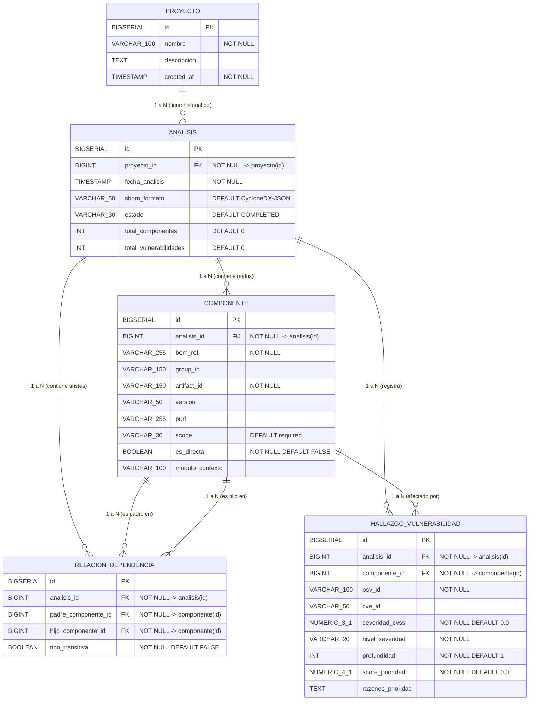
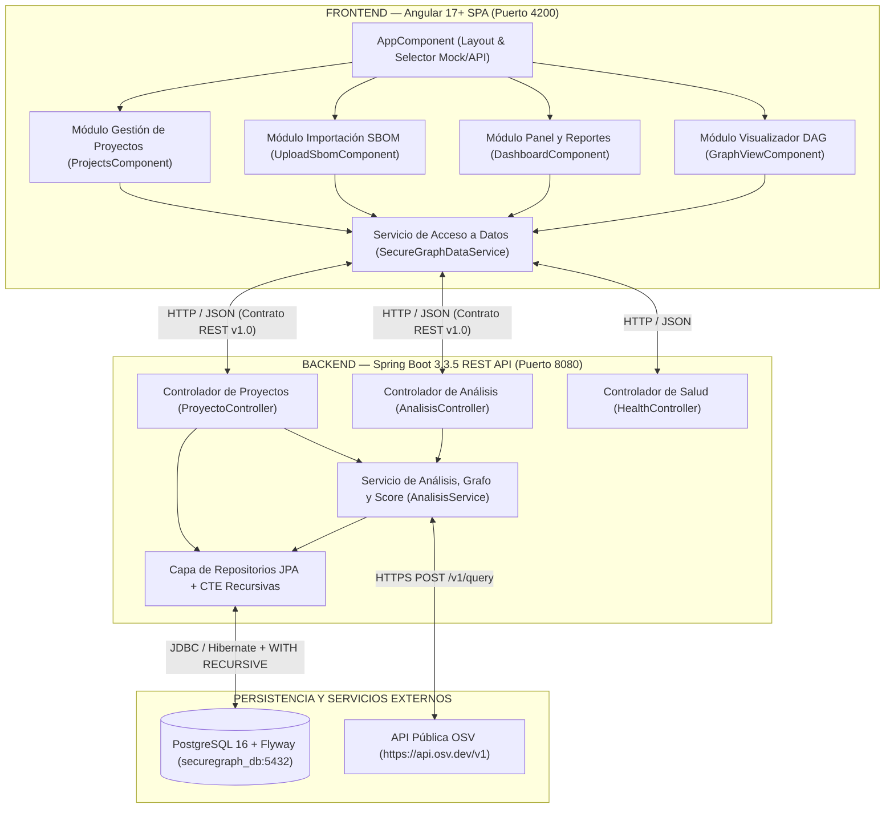

# UNIVERSIDAD TECNOLÓGICA NACIONAL
## FACULTAD REGIONAL LA PLATA (UTN - FRLP)
### Tecnicatura Universitaria en Programación — Trabajo Final Integrador (TFI)

---

# INFORME DE AVANCE — N° 1 (GUÍA 003)

| Campo | Detalle |
| :--- | :--- |
| **Nombre del proyecto** | SecureGraph: Plataforma web para el análisis y priorización de vulnerabilidades conocidas en dependencias de software mediante grafos |
| **Grupo** | Grupo N.° 9 |
| **Número de informe** | N° 1 (Otorga la condición de regularidad) |
| **Periodo que cubre** | Desde: 02/11/2026 — Hasta: 29/11/2026 |
| **Fecha de presentación** | 29/11/2026 |
| **Integrantes del equipo** | [Integrante 1 — Frontend] -- [Integrante 2 — Backend] |
| **Docente / Tutor asignado** | Ing. Antonini, Sergio |

---

## 1. Identificación del Proyecto

### 1.1 Datos generales del proyecto

| Campo | Definición |
| :--- | :--- |
| **Nombre del proyecto** | SecureGraph: Plataforma web para el análisis y priorización de vulnerabilidades conocidas en dependencias de software mediante grafos |
| **Descripción breve** | Aplicación web que importa inventarios SBOM en formato CycloneDX JSON de proyectos Java/Maven, persiste su árbol de dependencias como un grafo dirigido en PostgreSQL, consulta vulnerabilidades conocidas en la API pública de OSV y calcula un puntaje de priorización explicable (*SecureGraph Score*) acompañado de visualización interactiva del grafo. |
| **Tecnologías principales** | Angular 17+, TypeScript 5.4, Java 21, Spring Boot 3.3.5, PostgreSQL 16, Flyway, Maven, Docker Compose, CycloneDX JSON, API OSV |
| **Repositorio / URL** | `https://github.com/ampi-cs50/securegraph` |

### 1.2 Equipo de trabajo

| Integrante | Rol / Área | Correo de contacto |
| :--- | :--- | :--- |
| **[Integrante 1]** | Frontend, UI/UX, Visualización de Grafos y QA | [Completar en documento de entrega] |
| **[Integrante 2]** | Backend, Persistencia Relacional, Integración OSV y Motor de Score | [Completar en documento de entrega] |

---

## 2. Estado General del Avance

### 2.1 Porcentaje de avance global

| Avance planificado al cierre del periodo | Avance real al cierre del periodo | Diferencia (+ adelantado / - atrasado) |
| :---: | :---: | :---: |
| **50 %** | **50 %** | **0 % (En término)** |

### 2.2 Estado del proyecto respecto a la propuesta original

| Indicador | Estado | Observaciones |
| :--- | :--- | :--- |
| **Cronograma** | `[ ]` Adelantado `[X]` En término `[ ]` Atrasado | Se completaron en fecha las iteraciones previstas de diseño de base de datos, contrato API, ingesta base, panel de hallazgos y estructura del grafo interactivo. |
| **Alcance** | `[X]` Sin cambios `[ ]` Ampliado `[ ]` Reducido | Se mantiene sin alteraciones el alcance aprobado en la Propuesta de Proyecto (Guía 002). |
| **Calidad** | `[X]` Conforme `[ ]` Con desvíos | El esquema relacional valida con Flyway al iniciar el servicio y la comunicación entre Angular y Spring Boot cumple el contrato REST v1.0. |

### 2.3 Resumen narrativo del periodo
Durante este primer periodo (semanas 1 a 4 del cronograma), el equipo consolidó la arquitectura cliente-servidor desacoplada del sistema SecureGraph y configuró el entorno local reproducible mediante Docker Compose para PostgreSQL 16. En la primera etapa se definió y congeló el contrato de interfaz REST (`docs/api-contract.md`), lo que permitió que las áreas de Frontend y Backend trabajaran en paralelo sin bloqueos mutuos utilizando un servicio dual de datos simulados (*Modo Mock*) y conexión HTTP real.

En el área de Backend y Base de Datos, se diseñó e implementó la migración inicial con Flyway (`V1__init_schema.sql`), definiendo las cinco entidades nucleares del sistema (`proyecto`, `analisis`, `componente`, `relacion_dependencia` y `hallazgo_vulnerabilidad`) junto con sus índices y consultas SQL recursivas (`WITH RECURSIVE`) para el recorrido del Grafo Acíclico Dirigido (DAG). Asimismo, se estructuraron las capas de controladores REST, objetos de transferencia inmutables (Records DTO) y servicios de negocio para proyectos, análisis, hallazgos priorizados y topología del grafo.

En el área de Frontend, se construyó la aplicación SPA en Angular 17+ bajo arquitectura de componentes *Standalone* y gestión reactiva de estado con *Signals*. Se implementaron las cuatro vistas principales del sistema: la pantalla de administración y alta de proyectos, el formulario de importación y validación de archivos SBOM CycloneDX JSON, el panel de control (*Dashboard*) con tarjetas de métricas y tabla comparativa entre *SecureGraph Score* y *CVSS puro*, y el lienzo interactivo en SVG para visualizar el grafo de dependencias e inspeccionar cada nodo.

Para el próximo periodo (semanas 5 a 6, rumbo al Informe de Avance N° 2), la perspectiva del equipo se centra en profundizar la batería de pruebas unitarias y de integración con lotes SBOM de distinta complejidad, refinar los filtros combinados y la exportación técnica en JSON, y documentar la evaluación comparativa experimental entre el ordenamiento por grafo y el ordenamiento tradicional por CVSS.

---

## 3. Actividades del Periodo

### 3.1 Actividades planificadas para el periodo

| Actividad / Tarea | Fecha inicio planeada | Fecha fin planeada | Estado |
| :--- | :---: | :---: | :--- |
| 1. Especificación de requerimientos y contrato REST v1.0 | 02/11/2026 | 08/11/2026 | `[ ]` No iniciada `[ ]` En curso `[X]` Finalizada |
| 2. Diseño de la base de datos (esquema / DER) y de los módulos del sistema | 09/11/2026 | 15/11/2026 | `[ ]` No iniciada `[ ]` En curso `[X]` Finalizada |
| 3. Iteración 1: Carga de proyectos, validación SBOM CycloneDX y persistencia | 09/11/2026 | 15/11/2026 | `[ ]` No iniciada `[ ]` En curso `[X]` Finalizada |
| 4. Iteración 2: Consulta de vulnerabilidades (OSV) y Dashboard de hallazgos | 16/11/2026 | 22/11/2026 | `[ ]` No iniciada `[ ]` En curso `[X]` Finalizada |
| 5. Iteración 3: Motor *SecureGraph Score* explicable y visualizador de grafo DAG | 23/11/2026 | 29/11/2026 | `[ ]` No iniciada `[X]` En curso `[ ]` Finalizada |

### 3.2 Actividades iniciadas en el periodo

| Actividad | Fecha inicio real | Responsable(s) | Observaciones |
| :--- | :---: | :--- | :--- |
| Configuración de repositorio Git, ramas `main`/`develop` y Docker Compose | 02/11/2026 | Ambos integrantes | Se estableció también la guía de flujo Git y el contrato API v1.0. |
| Modelado SQL en PostgreSQL 16 y migración Flyway V1 | 09/11/2026 | Backend | Incluye índices sobre claves foráneas para optimizar consultas recursivas. |
| Desarrollo de layout principal, rutas y vistas de Proyectos y Carga SBOM | 09/11/2026 | Frontend | Implementado en Angular 17+ con selector de modo Mock / API Real. |
| Desarrollo de endpoints de análisis, resumen, hallazgos y grafo | 16/11/2026 | Backend | Estructurados mediante `AnalisisController` y `AnalisisService`. |
| Construcción del Dashboard comparativo y lienzo SVG del grafo | 18/11/2026 | Frontend | Cálculo dinámico de posiciones de nodos por nivel jerárquico (raíz, directas, transitivas). |

### 3.3 Actividades finalizadas en el periodo

| Actividad | Fecha finalización | Responsable(s) | Entregable generado |
| :--- | :---: | :--- | :--- |
| Definición del Contrato API REST v1.0 | 08/11/2026 | Ambos integrantes | `docs/api-contract.md` |
| Esquema de Base de Datos Relacional y Entidades JPA | 14/11/2026 | Backend | `V1__init_schema.sql` y paquete `domain/entity` |
| Módulo Frontend de Gestión de Proyectos e Importación SBOM | 15/11/2026 | Frontend | `projects.component.ts` y `upload-sbom.component.ts` |
| Panel de Consulta, Priorización Explicable y Exportación JSON | 22/11/2026 | Frontend | `dashboard.component.ts` |
| Elaboración de Diagramas Obligatorios (DER y Módulos) | 28/11/2026 | Ambos integrantes | Sección 7.2 del presente informe |

### 3.4 Actividades pendientes o en curso al cierre del periodo

| Actividad | % completado | Responsable(s) | Próximos pasos |
| :--- | :---: | :--- | :--- |
| Ajustes avanzados de interacción en el visualizador de grafo (Iteración 3) | **75 %** | Frontend | Incorporar filtros visuales en el grafo y resaltado de ruta completa al seleccionar un nodo vulnerable. |
| Ampliación de pruebas de integración con archivos SBOM extensos | **60 %** | Backend | Completar pruebas automatizadas sobre casos de borde y manejo de errores de red ante OSV. |

---

## 4. Contribución Individual de Cada Integrante

### Integrante 1 (Desarrollo Frontend y Visualización)

| Aspecto | Detalle |
| :--- | :--- |
| **Tareas realizadas en el periodo** | 1. Inicialización y configuración del proyecto Angular 17+ con arquitectura *Standalone* y enrutamiento.<br>2. Definición de interfaces TypeScript (`securegraph.models.ts`) alineadas al contrato REST v1.0.<br>3. Implementación de `SecureGraphDataService` con soporte dual (datos simulados en memoria y cliente HTTP hacia `localhost:8080`).<br>4. Desarrollo de las vistas de Gestión de Proyectos (`projects.component.ts`) e Importación de archivos SBOM CycloneDX (`upload-sbom.component.ts`) con validaciones de formato.<br>5. Construcción del Dashboard de hallazgos (`dashboard.component.ts`) con tarjetas de resumen, conmutador de ordenamiento (*SecureGraph Score* vs. *CVSS*) y exportación de reporte JSON.<br>6. Implementación del visualizador interactivo de grafo (`graph-view.component.ts`) mediante SVG dinámico e inspector de topología. |
| **Horas dedicadas (estimadas)** | **Total: 48 hs** |
| **Dificultades encontradas** | Disposición visual clara de los nodos del grafo para diferenciar dependencias directas y transitivas sin depender de librerías externas pesadas. |
| **Logros / aprendizajes destacados** | Implementación de un algoritmo de posicionamiento por columnas jerárquicas usando `computed` Signals de Angular 17 y renderizado SVG reactivo. |

### Integrante 2 (Desarrollo Backend y Persistencia)

| Aspecto | Detalle |
| :--- | :--- |
| **Tareas realizadas en el periodo** | 1. Configuración del proyecto Spring Boot 3.3.5 con Java 21, Maven, Spring Data JPA, Bean Validation y políticas CORS (`WebCorsConfig`).<br>2. Diseño del modelo de datos relacional en PostgreSQL 16 y escritura del script de migración versionada Flyway (`V1__init_schema.sql`).<br>3. Implementación de las 5 entidades JPA (`Proyecto`, `Analisis`, `Componente`, `RelacionDependencia`, `HallazgoVulnerabilidad`) y sus repositorios.<br>4. Escritura de la consulta recursiva (`WITH RECURSIVE`) en `RelacionDependenciaRepository` para explorar el DAG y calcular profundidades.<br>5. Implementación de DTOs inmutables (`record`), `AnalisisService`, `ProyectoController`, `AnalisisController`, `HealthController` y pruebas con `MockMvc`. |
| **Horas dedicadas (estimadas)** | **Total: 48 hs** |
| **Dificultades encontradas** | Prevención de ciclos infinitos eventuales al recorrer relaciones transitivas con consultas SQL recursivas en PostgreSQL. |
| **Logros / aprendizajes destacados** | Aplicación de expresiones de tabla comunes recursivas (`CTE`) con cota de profundidad y agrupación por camino mínimo (`MIN(profundidad)`). |

---

## 5. Aspectos Positivos y Negativos del Periodo

### 5.1 Aspectos positivos

| # | Descripción del aspecto positivo | Área / Categoría |
| :---: | :--- | :--- |
| **1** | La definición temprana del contrato REST (`docs/api-contract.md`) permitió desarrollar el Frontend y el Backend en paralelo sin bloqueos ni conflictos de integración. | Técnico / Gestión |
| **2** | El uso de Docker Compose y Flyway garantizó que la base de datos PostgreSQL 16 tenga exactamente el mismo esquema en las computadoras de ambos integrantes. | Técnico |
| **3** | La organización del trabajo mediante tablero Kanban en Trello y ramas `feature/*` en Git mantuvo un flujo ordenado y sin conflictos de *merge*. | Equipo / Gestión |
| **4** | La incorporación de la observación del tutor sobre la Propuesta (claridad descriptiva en el alcance) ayudó a alinear los criterios de aceptación de cada módulo. | Gestión |

### 5.2 Aspectos negativos o dificultades

| # | Descripción del aspecto negativo / dificultad | Área | Acción tomada o planificada |
| :---: | :--- | :--- | :--- |
| **1** | Error inicial de permisos/invitación en GitHub al vincular la cuenta del segundo integrante en el repositorio remoto. | Técnico / Externo | Se regeneró la invitación directamente por nombre de usuario y se verificó el acceso y clonación de la rama `develop`. |
| **2** | Dependencia innecesaria (`cytoscape`) instalada inicialmente en el `package.json` del frontend que aumentaba el tamaño del proyecto sin utilizarse. | Técnico | Se depuró `package.json` optando por renderizado SVG nativo en Angular, reduciendo dependencias externas. |

---

## 6. Gestión de Riesgos

### 6.1 Riesgos ocurridos durante el periodo

| Descripción del riesgo ocurrido | Probabilidad | Impacto | Plan de mitigación / Acción tomada |
| :--- | :---: | :---: | :--- |
| **Desfasaje temporal entre la disponibilidad de endpoints del backend y el desarrollo de pantallas en Angular** | Media | Alto | Se activó el *Modo Mock* en `SecureGraphDataService` respetando estrictamente los payloads de `docs/api-contract.md`, permitiendo construir y probar todas las vistas sin demoras. |

### 6.2 Riesgos identificados para el próximo periodo

| Descripción del riesgo potencial | Probabilidad | Impacto | Plan de prevención / mitigación |
| :--- | :---: | :---: | :--- |
| **Latencia o límites de tasa en la API pública de OSV al analizar SBOMs con gran cantidad de componentes** | Media | Alto | Configurar *timeouts* de 10 segundos en `application.yml`, agrupar consultas y disponer de lotes de prueba cacheados. |
| **Archivos SBOM CycloneDX generados por distintas versiones del plugin Maven con campos opcionales ausentes** | Alta | Medio | Validar campos nulos de forma defensiva en el parser (como `purl`, `scope` o `cveId`) asignando valores por defecto documentados. |
| **Acumulación de tareas de redacción del Informe Técnico Final sobre las últimas semanas de diciembre** | Media | Alto | Redactar los capítulos de arquitectura, ADRs y manuales de forma incremental junto con el Informe de Avance N° 2. |

---

## 7. Estado de los Entregables y Calidad

### 7.1 Entregables del periodo

| Entregable | Estado | Versión / Fecha | Link / Ubicación |
| :--- | :--- | :---: | :--- |
| **Contrato API REST y Flujo Git** | `[ ]` Pendiente `[ ]` En progreso `[X]` Completo | v1.0 — 08/11/2026 | `docs/api-contract.md` y `docs/git-workflow.md` |
| **Esquema Relacional PostgreSQL 16 (Flyway V1)** | `[ ]` Pendiente `[ ]` En progreso `[X]` Completo | v1.0 — 14/11/2026 | `backend/src/main/resources/db/migration/V1__init_schema.sql` |
| **API Backend Base (Proyectos, Análisis, Grafo y Reporte)** | `[ ]` Pendiente `[ ]` En progreso `[X]` Completo | v0.1 — 25/11/2026 | `backend/src/main/java/ar/edu/utn/frlp/securegraph/` |
| **Aplicación Frontend SPA (Proyectos, Carga SBOM, Dashboard y Grafo)** | `[ ]` Pendiente `[ ]` En progreso `[X]` Completo | v0.1 — 27/11/2026 | `frontend/src/app/` |

---

### 7.2 Diagramas obligatorios (Informe de Avance N° 1)

| Diagrama | Estado | Versión / Fecha | Link / Ubicación |
| :--- | :--- | :---: | :--- |
| **Esquema de la base de datos (DER)** | `[ ]` Pendiente `[ ]` En progreso `[X]` Completo | v1.0 — 28/11/2026 | Sección 7.2.1 de este documento y `V1__init_schema.sql` |
| **Diagrama de módulos del sistema** | `[ ]` Pendiente `[ ]` En progreso `[X]` Completo | v1.0 — 28/11/2026 | Sección 7.2.2 de este documento |
| **Listado de módulos a desarrollar** | `[ ]` Pendiente `[ ]` En progreso `[X]` Completo | v1.0 — 28/11/2026 | Sección 7.2.3 de este documento |

#### 7.2.1 Esquema Completo de la Base de Datos (Diagrama Entidad-Relación — DER)



*(Representación textual equivalente del esquema relacional implementado en PostgreSQL 16):*
```text
+---------------------------------------------------------------------------------+
|                   ESQUEMA DE BASE DE DATOS (POSTGRESQL 16)                      |
+---------------------------------------------------------------------------------+

 [ PROYECTO ]
   - id: BIGSERIAL (PK)
   - nombre: VARCHAR(100) NOT NULL
   - descripcion: TEXT
   - created_at: TIMESTAMP NOT NULL
        | 1
        | N (ON DELETE CASCADE)
 [ ANALISIS ]
   - id: BIGSERIAL (PK)
   - proyecto_id: BIGINT (FK -> PROYECTO.id)
   - fecha_analisis: TIMESTAMP NOT NULL
   - sbom_formato: VARCHAR(50) NOT NULL
   - estado: VARCHAR(30) NOT NULL
   - total_componentes: INT NOT NULL
   - total_vulnerabilidades: INT NOT NULL
        | 1
        +-----------------------------------+
        | N                                 | N
 [ COMPONENTE ]                      [ HALLAZGO_VULNERABILIDAD ]
   - id: BIGSERIAL (PK)                - id: BIGSERIAL (PK)
   - analisis_id: BIGINT (FK)          - analisis_id: BIGINT (FK -> ANALISIS.id)
   - bom_ref: VARCHAR(255)             - componente_id: BIGINT (FK -> COMPONENTE.id)
   - group_id: VARCHAR(150)            - osv_id: VARCHAR(100) NOT NULL
   - artifact_id: VARCHAR(150)         - cve_id: VARCHAR(50)
   - version: VARCHAR(50)              - severidad_cvss: NUMERIC(3,1)
   - purl: VARCHAR(255)                - nivel_severidad: VARCHAR(20)
   - scope: VARCHAR(30)                - profundidad: INT
   - es_directa: BOOLEAN NOT NULL      - score_prioridad: NUMERIC(4,1)
   - modulo_contexto: VARCHAR(100)     - razones_prioridad: TEXT
        | 1 (padre)     | 1 (hijo)
        +-------+-------+
                | N
 [ RELACION_DEPENDENCIA ] (Aristas Dirigidas del Grafo DAG)
   - id: BIGSERIAL (PK)
   - analisis_id: BIGINT (FK -> ANALISIS.id)
   - padre_componente_id: BIGINT (FK -> COMPONENTE.id)
   - hijo_componente_id: BIGINT (FK -> COMPONENTE.id)
   - tipo_transitiva: BOOLEAN NOT NULL
```

#### 7.2.2 Diagrama de Módulos del Sistema



#### 7.2.3 Listado de Módulos a Desarrollar, Responsabilidades y Relaciones

| Módulo | Capa / Ubicación | Responsabilidad Principal | Relaciones / Dependencias |
| :--- | :--- | :--- | :--- |
| **1. Gestión de Proyectos (`ProjectsComponent`)** | Frontend (`frontend/src/app/pages/projects`) | Permite registrar nuevos proyectos Java/Maven y consultar el inventario de aplicaciones junto con la cantidad de análisis realizados. | Consume `GET /api/proyectos` y `POST /api/proyectos` a través de `SecureGraphDataService`. |
| **2. Importador SBOM (`UploadSbomComponent`)** | Frontend (`frontend/src/app/pages/upload-sbom`) | Valida que el archivo seleccionado sea un `.json` CycloneDX, permite asociarlo a un proyecto existente y dispara el análisis. | Consume `POST /api/proyectos/{id}/analisis` (`multipart/form-data`) y redirige al Dashboard. |
| **3. Panel Comparativo y Exportador (`DashboardComponent`)** | Frontend (`frontend/src/app/pages/dashboard`) | Muestra indicadores de severidad, permite alternar entre *SecureGraph Score* y *CVSS Puro*, filtrar por severidad, leer razones explicables y descargar el informe JSON. | Consume `GET /api/analisis/{id}/hallazgos` y `GET /api/analisis/{id}/reporte`. |
| **4. Visualizador Interactivo de Grafo (`GraphViewComponent`)** | Frontend (`frontend/src/app/pages/graph-view`) | Renderiza dinámicamente en SVG el Grafo Acíclico Dirigido (nodos por nivel y aristas orientadas) e incluye el panel inspector de topología. | Consume `GET /api/analisis/{id}/grafo` a través de `SecureGraphDataService`. |
| **5. Capa de Exposición REST (`web/controller` y `web/dto`)** | Backend (`backend/.../web`) | Expone los endpoints definidos en el contrato REST v1.0, valida peticiones entrantes y serializa respuestas mediante `record` DTOs inmutables. | Se comunica con `AnalisisService` y los repositorios JPA; aplica políticas CORS desde `WebCorsConfig`. |
| **6. Motor de Análisis, OSV y Score (`AnalisisService`)** | Backend (`backend/.../service`) | Procesa el inventario CycloneDX, consulta vulnerabilidades en OSV, calcula el *SecureGraph Score* con sus razones explicables y ensambla el reporte técnico. | Invoca a la API externa de OSV y coordina la lectura/escritura con los repositorios de persistencia. |
| **7. Persistencia Relacional y de Grafos (`repository` y `domain/entity`)** | Backend (`backend/.../repository`) | Mapea las 5 tablas de PostgreSQL 16 y ejecuta consultas SQL recursivas (`WITH RECURSIVE`) para determinar caminos y profundidades en el árbol de dependencias. | Se conecta con la instancia PostgreSQL 16 gestionada mediante migraciones Flyway (`V1__init_schema.sql`). |

---

### 7.3 Calidad del software — Pruebas realizadas

| Módulo / Funcionalidad | Tipo de prueba | Responsable | Resultado | Observaciones |
| :--- | :--- | :--- | :---: | :--- |
| Endpoint de Salud (`GET /api/health`) | Unitaria (`@WebMvcTest` / JUnit 5) | Backend | `[X]` OK `[ ]` Fallo `[ ]` Parcial | Verificado mediante `HealthControllerTest` con `MockMvc`. |
| Endpoints de Resumen, Hallazgos, Grafo y Reporte (`/api/analisis/42/*`) | Unitaria (`@WebMvcTest` / JUnit 5) | Backend | `[X]` OK `[ ]` Fallo `[ ]` Parcial | Verificado mediante `AnalisisControllerTest` comprobando estructura JSON y ordenamiento. |
| Validación de carga de archivos SBOM (`.json` vs formatos inválidos) | Funcional / Usabilidad | Frontend | `[X]` OK `[ ]` Fallo `[ ]` Parcial | El componente rechaza extensiones no válidas y muestra alerta descriptiva antes de enviar. |
| Conmutación de ordenamiento (*SecureGraph Score* vs *CVSS Puro*) y filtro por severidad | Funcional / Integración | Frontend | `[X]` OK `[ ]` Fallo `[ ]` Parcial | La tabla reordena los hallazgos y actualiza la vista respetando el criterio seleccionado. |
| Renderizado dinámico e inspección de nodos en Grafo SVG | Usabilidad / E2E | Frontend | `[X]` OK `[ ]` Fallo `[ ]` Parcial | Probado en navegador verificando selección de nodos e inspección de aristas `DIRECT` y `TRANSITIVE`. |

---

## 8. Comunicación y Reuniones

### 8.1 Reuniones del equipo

| Fecha | Duración | Participantes | Principales temas tratados |
| :---: | :---: | :--- | :--- |
| 03/11/2026 | 60 minutos | Ambos integrantes | Definición de arquitectura desacoplada, división de carpetas (`frontend/` y `backend/`) y redacción de la propuesta. |
| 08/11/2026 | 45 minutos | Ambos integrantes | Acuerdos del contrato REST v1.0 (`docs/api-contract.md`), definición de payloads JSON y flujo de ramas en Git. |
| 16/11/2026 | 50 minutos | Ambos integrantes | Revisión del esquema de base de datos PostgreSQL (`V1__init_schema.sql`) y diseño de las 4 pantallas de Angular. |
| 25/11/2026 | 60 minutos | Ambos integrantes | Pruebas de integración entre servicios de Angular y controladores de Spring Boot; preparación de diagramas del Informe N° 1. |

### 8.2 Reuniones / consultas con el tutor

| Fecha | Temas abordados | Acuerdos / Decisiones tomadas |
| :---: | :--- | :--- |
| 05/11/2026 | Presentación formal de la Propuesta de Proyecto (Guía 002). | Propuesta recibida por la cátedra; asignación del **Grupo N.° 9**. |
| 19/11/2026 | Devolución del tutor sobre la Propuesta de Proyecto. | Propuesta aprobada con ajuste menor de redacción en la sección 4.1 (expresar el alcance incluido de forma descriptiva sin duplicar códigos RF). |

---

## 9. Planificación del Próximo Periodo

### 9.1 Objetivos para el próximo periodo

| Objetivo / Tarea planificada | Responsable(s) | Fecha estimada de finalización |
| :--- | :--- | :---: |
| 1. Completar mejoras de interacción y filtrado en el visualizador de grafos en Angular | Frontend | 04/12/2026 |
| 2. Ampliar la suite de pruebas unitarias y de integración en Backend con distintos archivos SBOM | Backend | 06/12/2026 |
| 3. Ejecutar pruebas comparativas reproducibles (*SecureGraph Score* vs. *CVSS Puro*) | Ambos integrantes | 10/12/2026 |
| 4. Redactar y presentar el **Informe de Avance N° 2 (Guía 003)** con matriz de calidad completa | Ambos integrantes | 13/12/2026 |
| 5. Iniciar la redacción de manuales (Usuario e Implementación) y ADRs para el Informe Técnico Final | Ambos integrantes | 18/12/2026 |

### 9.2 Recursos o apoyos que el equipo necesita del tutor o de la cátedra
Validación del esquema de base de datos (DER) y del diagrama de módulos presentados en la sección 7.2 de este informe para confirmar la aprobación de la regularidad y avanzar hacia el cierre de las pruebas integrales del Informe de Avance N° 2.

---

## 10. Reflexión del Equipo

### 10.1 ¿Qué aprendimos como equipo en este periodo?
Aprendimos que acordar y documentar un contrato de API REST estricto antes de empezar a programar los módulos permite que el desarrollo de Frontend y Backend avance en paralelo a máxima velocidad. Asimismo, comprobamos el valor de las consultas recursivas (`WITH RECURSIVE`) en PostgreSQL para resolver estructuras de grafos sin necesidad de sumar motores de bases de datos adicionales al despliegue en Docker.

### 10.2 ¿Qué haríamos diferente?
Organizaríamos desde el primer día la totalidad de las subtareas técnicas en el tablero Kanban con criterios de aceptación más granulares por pantalla y endpoint, y verificaríamos con anticipación la configuración de permisos de colaboradores en GitHub para evitar demoras iniciales al clonar el repositorio.

### 10.3 Nivel de satisfacción del equipo con el periodo

| Dimensión | Puntuación | Comentarios |
| :--- | :--- | :--- |
| **Avance técnico** | `[ ]`1 `[ ]`2 `[ ]`3 `[ ]`4 `[X]`5 | Se logró una base funcional sólida tanto en Spring Boot/PostgreSQL como en las 4 vistas de Angular. |
| **Trabajo en equipo** | `[ ]`1 `[ ]`2 `[ ]`3 `[ ]`4 `[X]`5 | Excelente división de responsabilidades sin conflictos de código gracias a la separación por directorios y ramas. |
| **Comunicación interna** | `[ ]`1 `[ ]`2 `[ ]`3 `[ ]`4 `[X]`5 | Coordinación fluida y constante para mantener sincronizados los modelos TypeScript y los DTOs de Java. |
| **Gestión del tiempo** | `[ ]`1 `[ ]`2 `[ ]`3 `[X]`4 `[ ]`5 | Se cumplieron los hitos del periodo en término, manteniendo margen para las pruebas del próximo informe. |

---

## 11. Declaración y Firmas

Los integrantes del equipo declaramos que la información contenida en este informe es veraz y refleja fielmente el estado real del proyecto al cierre del periodo indicado.

| Integrante / Rol | Firma y aclaración | Fecha |
| :--- | :---: | :---: |
| **[Integrante 1 — Frontend]** | ________________________ | 29/11/2026 |
| **[Integrante 2 — Backend]** | ________________________ | 29/11/2026 |

### RECIBIDO Y REVISADO POR EL TUTOR

| Firma del tutor | Aclaración | Fecha de revisión |
| :---: | :---: | :---: |
| ________________________ | Ing. Sergio Antonini | ____/____/2026 |

* **Observaciones del tutor:** ____________________________________________________________________
